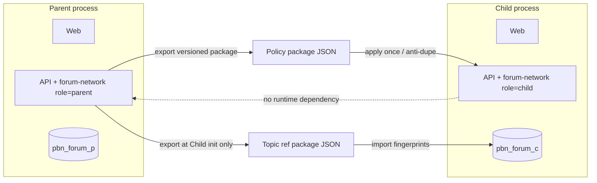

# PBN Parent/Child Forum Addon — Implementation Report

**Date:** 2026-11-05 (Asia/Bangkok)  
**Machine:** DESKTOP — PBN (`D:\workspace-2026\pbn`)  
**Scope:** Parent/Child addon on independent process+DB forums. OPS optional stub only.  
**Fixtures:** `forum_p` / `forum_c` only. **Forum A (`pbn_dev`) and Forum B (`pbn_forum_b`) were not migrated, seeded, or admin-written.**  
**Git:** No commit / no push.

---

## A. Audit verdict (reuse-first)

| Area | Finding | Reuse |
|------|---------|-------|
| Multi-forum | Separate process + DB via `forums/*.json` + `scripts/forum.mjs` | **Primary path** for Child create |
| Source reuse | Same monorepo; env injected per forum | Unchanged |
| DB isolation | No `site_id`; no shared sessions/wallets | Preserved |
| Bootstrap | Baseline `apps/api/baseline` + seeders | Extended with forward patches 0005–0012 |
| Credit/Ledger | Per-DB `sys_*` | Child-local |
| Pricing / Free Mode | `forum-local-pricing` | Extended `expiresAt` |
| OPS | Optional enrollment | **Not required**; adapter stub only |
| Extensions | AutoLoad `src/extensions/` | New `forum-network` |

No multi-tenant schema was introduced.

---

## B. Architecture



**Principles**

1. Parent is a **role** (`forum_network_settings.role = parent|child|none`), enableable on any forum — not hardcoded to `forum_p`.
2. Child keeps last applied managed policy locally; **Parent offline does not block** login, post, credit, pin, Free Mode.
3. Field classes:
   - **Template** — init only
   - **Managed** — versioned sync
   - **Local** — never overwritten by Parent

---

## C. Create Child wizard

```bash
node scripts/forum-network.mjs create-child \
  --config forums/forum-c.json \
  --parent forums/forum-p.json \
  --template default \
  --free-months 2
```

Steps: validate → ensure Parent → configure → `CREATE DATABASE` (refuse if exists) → baseline migrate → forward patches → seed → admin → template commercial + Free Mode window → managed policy → topic refs → link registry → health → JSON report.

**Safety**

- Refuses `forum_a` / `forum_b` / `pbn_dev` / `pbn_forum_b`
- Never `DROP DATABASE` on failure (operator review; fixtures may use `destroy-fixture` for `forum_p`/`forum_c` only)
- No copy of users, wallets, sessions, or secrets from Parent

---

## D. Config sync

| Class | Examples | Behavior |
|-------|----------|----------|
| Template | branding, credit seed, Free Mode initial, service price seed | Apply at init only |
| Managed | moderation/spam samples, service catalog hints, SEO technical, locale catalog | Version + checksum; apply; skip duplicate version |
| Local | `free_mode`, `vnd_per_credit`, users, topics, ledger, OPS connection | Never written by policy apply |

CLI:

```bash
node scripts/forum-network.mjs export-policy forums/forum-p.json --out path.json
node scripts/forum-network.mjs apply-policy forums/forum-c.json --package path.json
```

---

## E. Topic reference snapshot

- Exported at Child init (template titles + optional Parent titles only)
- Stored in `forum_topic_reference_snapshots` (hash + normalized title)
- **Not** published as Child topics
- No continuous sync

---

## F. Parent offline

E2E stopped Parent API; Child `/api/auth/me` and local-pricing still returned 200. No Installation Key / OPS required.

---

## G. OPS-SERVER

`opsAdapter.js` returns `status: 'unsupported'`. No OPS-SERVER edits. No Installation Key for Child operation.

---

## H. E2E results

Command: `node scripts/test-forum-network-e2e.mjs`  
Evidence: [PBN-PARENT-CHILD-E2E-RESULTS.json](./PBN-PARENT-CHILD-E2E-RESULTS.json), [parent-child/](./parent-child/)

| Check | Result |
|-------|--------|
| Create Child + migration + config | PASS |
| DB isolation / no user leak | PASS |
| Admin login (own forum) | PASS |
| Cross-login rejected | PASS |
| Post topic | PASS |
| Credit wallet readable | PASS |
| Paid pin under Free Mode (no OPS) | PASS |
| Free Mode with expiry | PASS |
| Policy version apply + duplicate skip | PASS |
| Parent offline → Child works | PASS |
| Child offline clean stop | PASS |
| Topic refs not public | PASS |
| Forum A/B untouched | PASS (guards + fixture-only DBs) |

**Summary: 23 passed, 0 failed.**

---

## I. Files changed / added

### New

- `apps/api/src/extensions/forum-network/` — schema, service, routes, OPS adapter stub, constants
- `apps/api/baseline/0012_forum_network.sql`
- `scripts/forum-network.mjs` — CLI wizard
- `scripts/test-forum-network-e2e.mjs`
- `forums/forum-p.json`, `forums/forum-c.json`
- `forums/templates/default.json`
- `docs/audit/PBN-PARENT-CHILD-ADDON-REPORT.md` (+ E2E JSON)

### Modified

- `apps/api/src/db/schema.js` — re-export network schema
- `apps/api/src/extensions/forum-local-pricing/services/localPricingService.js` — Free Mode `expiresAt`
- `apps/api/src/extensions/forum-local-pricing/routes/admin.js` — accept `expiresAt`

### Forward patches (greenfield fixtures only)

Applied via `pbn_meta.forward_patches` (not appended to immutable baseline manifest in this task):  
`0005`–`0011` existing commercial SQL + `0012_forum_network.sql`.

**PO note:** Promoting 0005–0012 into `baseline/manifest.json` v7 + `catalog-v7.json` should be a separate approved migration step before touching production or Forum A/B.

---

## Operator guide — create a new Child

1. Copy `forums/forum-c.json` → new id/database/ports (unique).
2. Ensure Parent has role enabled:  
   `node scripts/forum-network.mjs enable-parent forums/<parent>.json`
3. Create Child:  
   `node scripts/forum-network.mjs create-child --config forums/<child>.json --parent forums/<parent>.json --template default --free-months 1|2|3`
4. Optional policy updates later via export/apply.
5. Start: `node scripts/forum.mjs start forums/<child>.json`
6. Admin password: `.local/forums/<child_id>/admin.json`

---

## Out of scope / next decisions

- Which real forum becomes Parent in production (after E2E; not decided here)
- Manifest v7 catalog promotion for A/B adopt
- Web admin wizard UI (CLI is sufficient for this task)
- Continuous topic sync (explicitly rejected)
